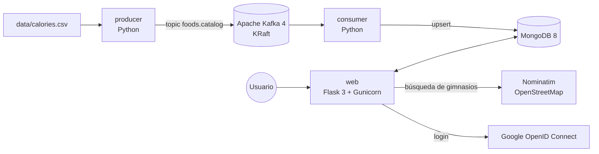

# FitnessApp 2.0

Catálogo de calorías de 2.224 alimentos, favoritos, planificador de dietas con
calendario y buscador de gimnasios en España con mapa.

Es la versión modernizada (2026) del Trabajo de Fin de Grado de **Desarrollo de Aplicaciones
Multiplataforma** que hice en 2023. La original sigue intacta en `C:\FitnessApp`.

- 📄 Qué ha cambiado y por qué: [docs/CAMBIOS.md](docs/CAMBIOS.md)
- 🚀 Cómo desplegarlo para el portfolio: [docs/DESPLIEGUE.md](docs/DESPLIEGUE.md)

## Arquitectura



| Servicio   | Qué hace                                                                 |
|------------|--------------------------------------------------------------------------|
| `producer` | Lee el CSV y publica cada fila en Kafka. Se ejecuta una vez y termina.    |
| `kafka`    | Broker de mensajes (sin ZooKeeper, modo KRaft).                          |
| `consumer` | Lee Kafka, normaliza los datos y los guarda en MongoDB. Se queda escuchando. |
| `mongodb`  | Base de datos: alimentos, usuarios y dietas.                             |
| `web`      | La aplicación Flask que ve el usuario.                                   |
| `kafka-ui` | (Opcional) Panel web para ver los mensajes de Kafka.                     |

## Arrancarlo en local

Requisito: [Docker Desktop](https://www.docker.com/products/docker-desktop/).

```bash
cp .env.example .env
```

Abre `.env` y cambia como mínimo `SECRET_KEY`, `MONGO_ROOT_PASSWORD` y `MONGO_APP_PASSWORD`.

```bash
docker compose up --build
```

Abre <http://localhost:8000> y pulsa **Log in → Try it as a guest**.

La primera vez tarda un poco: Kafka arranca, el productor publica las ~2.200 filas y el
consumidor las guarda en MongoDB. Puedes verlo con `docker compose logs -f producer consumer`.

Panel de Kafka opcional (<http://localhost:8080>):

```bash
docker compose --profile tools up -d kafka-ui
```

### Login con Google (opcional)

1. En <https://console.cloud.google.com/apis/credentials> crea un **ID de cliente de OAuth**
   de tipo *Aplicación web*.
2. URI de redirección autorizada: `http://localhost:8000/auth/callback`
3. Copia el ID y el secreto en `GOOGLE_CLIENT_ID` y `GOOGLE_CLIENT_SECRET` del `.env`.
4. `docker compose up -d web` para que lo recoja.

Si los dejas vacíos, la app funciona igual solo con el modo invitado.

## Variables de entorno

| Variable | Obligatoria | Descripción |
|---|---|---|
| `SECRET_KEY` | Sí | Firma las cookies de sesión. Larga y aleatoria. |
| `MONGO_URI` | Sí* | Conexión a MongoDB. *En docker-compose se construye sola con `MONGO_APP_USER/PASSWORD`. |
| `MONGO_ROOT_USER` / `MONGO_ROOT_PASSWORD` | Sí (compose) | Administrador de MongoDB, solo para crearlo. |
| `MONGO_APP_USER` / `MONGO_APP_PASSWORD` | Sí (compose) | Usuario con permisos solo sobre la base de datos `fitnessapp`. |
| `GOOGLE_CLIENT_ID` / `GOOGLE_CLIENT_SECRET` | No | Activan el botón de Google. |
| `DEMO_MODE` | No (`true`) | Muestra “Try it as a guest”. Los invitados se borran solos a los 7 días (`GUEST_TTL_DAYS`). |
| `SEED_ON_START` | No (`false`) | Si la colección de alimentos está vacía, la web la carga del CSV. Para desplegar sin Kafka. |
| `NOMINATIM_USER_AGENT` | Recomendada | Identificación que exige OpenStreetMap; pon un email de contacto. |
| `SESSION_COOKIE_SECURE` | No (`true`) | Cookie solo por https. En local compose la pone a `false`. |
| `PROXY_COUNT` | No (`1`) | Nº de proxies delante (Render, Caddy…) para generar URLs https. `0` en local. |

## Estructura

```
FitnessApp2026/
├── docker-compose.yml        # entorno completo
├── render.yaml               # despliegue en Render (solo web + MongoDB Atlas)
├── .env.example              # plantilla de configuración (el .env real NO se sube)
├── data/calories.csv         # dataset (antes estaba duplicado en 3 carpetas)
├── mongo/init-app-user.js    # crea el usuario de la app en MongoDB
├── web/                      # aplicación Flask
│   ├── Dockerfile
│   ├── pyproject.toml / uv.lock
│   ├── fitnessapp/
│   │   ├── __init__.py       # create_app(): app factory
│   │   ├── config.py         # configuración desde variables de entorno
│   │   ├── db.py             # conexión a MongoDB e índices
│   │   ├── auth.py           # usuario actual, login_required, redirecciones seguras
│   │   ├── forms.py          # formularios con validación + CSRF
│   │   ├── blueprints/       # rutas: auth, foods, favorites, diets, gyms, main
│   │   ├── services/         # lógica de negocio y acceso a datos
│   │   ├── templates/        # Jinja2 (Bootstrap 5.3)
│   │   └── static/           # CSS, JS y logos
│   └── tests/                # pytest contra un MongoDB real
├── pipeline/                 # productor y consumidor de Kafka (una imagen, dos comandos)
│   ├── Dockerfile
│   ├── fitness_pipeline/
│   └── tests/
└── .github/workflows/ci.yml  # tests + lint + build en cada push
```

## Tests y calidad

39 tests (37 de la web y 2 del pipeline) contra un MongoDB real y desechable, más
`ruff` (lint y formato). Todo con un solo comando, sin instalar Python:

```bash
docker compose --profile test run --rm tests
```

Arranca un MongoDB temporal en memoria, instala las dependencias exactas de `uv.lock` y
ejecuta ruff y pytest en `web/` y `pipeline/`. Al terminar, para quitar ese MongoDB temporal
(sin tocar el resto de servicios):

```bash
docker compose --profile test rm -sf mongo-test
```

Si tienes [uv](https://docs.astral.sh/uv/) y un MongoDB en `localhost:27017`, también puedes
hacer `cd web && uv run pytest` (la URL se cambia con `MONGO_TEST_URI`).

En GitHub, cada push ejecuta lo mismo automáticamente (`.github/workflows/ci.yml`).
